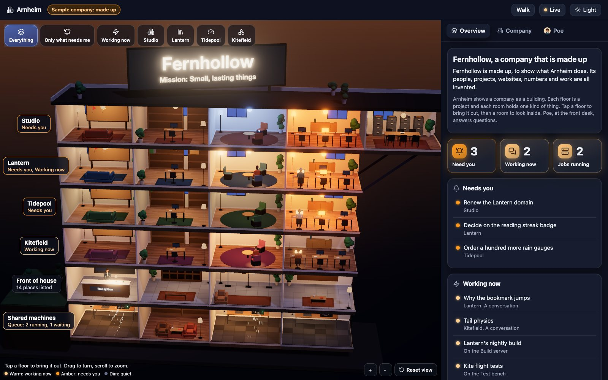
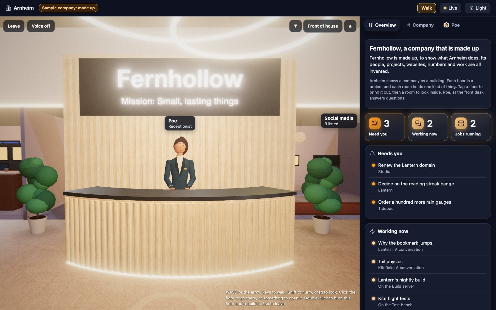

# Arnheim



Your company as a building you can walk through and talk to. Each project is a floor, each kind of
work is a room, and the work lights up as it happens. The people inside are your agents at work:
walk up to one and ask how it's going. A receptionist at the front desk answers questions about the
whole company, and your assistant waits in your office at the top.

Arnheim shows the work and never does it. It reads plain files, or what your own page gives it, and
changes none of them. It is free and open, and never sold.

## Start

You need Python 3.7 or newer and a browser with WebGL 2 (any current Chrome, Edge, Firefox or
Safari). There is nothing to install. In this folder:

```bash
python3 serve.py
```

Then open http://127.0.0.1:8740. It shows Fernhollow, a made-up company, until you add your own.

On Windows, run `py serve.py`. For another port, `python3 serve.py 8741`. On a Mac, the first
`python3` may offer to install Apple's command line tools, which bring Python: say yes. Arnheim has
been used on macOS in Chrome and Safari; Linux and Windows should work but haven't been tried.

## Walk through it



Press **Walk** to step inside, at the reception.

- **Move** with WASD or the arrow keys on a computer, or the stick on a phone. Drag to look round.
  Tap the floor to walk there.
- **Change floors** in the lift at the end of each floor's hall: walk in and pick a floor. Or use
  ▲ and ▼ beside the floor's name at the top (Page Up and Page Down on a keyboard), or tap the
  name for the list of floors. Your office is at the top, the shared machines are in the basement.
- **Open** anything by tapping it: a desk, a screen, a person.
- **Leave** with the Leave button or Esc.

A walk round goes like this. You start at reception: step into the ring in front of the
receptionist and ask what needs you. Take the lift to a floor lit warm, where work is going on.
Its rooms open onto the hall, and each agent at work has a ring beside them: step in, or tap them,
and ask how it's going. Then the lift again, to the next floor, or up to your office.

With reduced motion on, the camera keeps still and floors change at once. On a slow computer or
phone, add `?lite` to the address.

## Talk to the people

Each person in the building has a ring of light on the floor beside them. Step into it and a
conversation opens, with no button to press. Type, or turn on **Voice** to speak and hear them
answer aloud ("Voice", below).

- **Your agents.** Someone sits at a desk or in a chair while work is being done, or while they
  wait for you. Tap them to walk up. Ask how it's going, what's next, or whether they need you. In
  the sample they answer from lines written for them in `sample/work.json`. Connected to Claude
  Code, they tell you what Claude last said, and with control on, what you say reaches the agent
  itself (below).
- **The receptionist**, at the front desk on a walk and in the panel under their name, knows the
  whole company (below). On a walk, talk to them out loud like anyone else: turn on Voice, step
  into their ring and ask.
- **Your assistant**, at their own desk in your office, if you have one. In the sample they answer
  as the receptionist does; your own page can give them their own answers.

Your office also holds your notes: the newest eight hang in its library. Tap one, or stand in its
light, to read it.

### What the receptionist knows, and what they can do

Everything they know comes from your own files: `company.json` and `work.json`, and the feeds you
connect ([docs/connect.md](docs/connect.md)). They match the words of your question to what those
files say. There is no AI and nothing leaves your computer, and when the files don't say, they say
they don't know. Switch on the brain, and they answer anything with Claude ("Talk about anything",
below).

- **Ask them** what needs you, what's running, what's happening on a floor, what a room is for and
  what's in it, about goals, pull requests, websites, email and machines, who runs the company,
  or what the colours mean.
- **Take me there**: an answer about something has a link that takes you to it.
- **Show me round**: in the panel, they take you round the building, floor by floor.
- **"Remind me to ..."** adds a task. The page Arnheim comes with keeps it in that browser tab
  only.
- **Talk out loud** on a walk: with Voice on, just speak in their ring, and they answer aloud. In
  the panel, **Read aloud** has them speak their answers.

They never merge, publish, run jobs or sign in. A page of your own can teach them more words and
topics, or give them answers of its own ([docs/embed.md](docs/embed.md)).

## Make it yours

Your company goes in a folder called `data`, beside `sample`:

```bash
mkdir data
cp sample/*.json data/
```

(On Windows: `mkdir data`, then `copy sample\*.json data`.) Change the copies and reload the page.
Git ignores `data/`, so your files stay on your computer.

- `company.json` is the map: your company's name and mission, a floor for each project with its
  rooms, the founder (you), the receptionist and your assistant. Take out the `"sample"` line,
  which marks a company as made up.
- `work.json` is what is going on: tasks, goals, conversations, pull requests, websites,
  machines. Empty the `story` at the end (`"story": []`): it only makes the sample move.
- `notes.json` is your notes, for your office. Optional.

[docs/data.md](docs/data.md) lists every field. If a file has a mistake, the page says which file
and what is wrong.

### Name them and choose their faces

The receptionist and your assistant are yours to name, dress and give a voice, in
`company.json`:

```json
"receptionist": { "name": "Iris", "voice": "af_heart",
  "look": { "skin": "#a26b48", "hair": "#2b1d18", "coat": "#5b3b5e" } },
"assistant": { "name": "Wren", "title": "Your assistant", "voice": "bf_emma",
  "look": { "style": "bun", "hair": "#5a3926", "coat": "#a8752b" } }
```

`look` takes colours for skin, hair, lips, coat, shirt and trousers, a hair style (`bun`, `braids`
or the default swept cut), a round face, and touches such as a round collar, a brooch and
earrings. Anything you leave out keeps the default. Without an `assistant`, your office has none.

## Connect your agents

Connected to Claude Code, each conversation you have with Claude shows on its project's floor:
someone sits while Claude works, the floor turns amber when Claude needs your permission or an
answer, and a blue light shows when it is your turn. git and GitHub add unsaved changes and open
pull requests. Three steps, all in [docs/connect.md](docs/connect.md):

1. In `data/company.json`, give each floor its project's folder, and list the connectors' files as
   `feeds`.
2. Add Arnheim's hooks to Claude Code's settings.
3. For git and GitHub, run `python3 connect/projects.py --every 60` beside `serve.py`.

Then, if you like, switch on control: start Arnheim with `python3 serve.py --control`, and from
the building you can talk to your agents for real, answer their permission requests with Allow or
Deny, stop them, and start new ones on a project, by typing or out loud. It answers only the page on
your computer ([docs/connect.md](docs/connect.md), step 4).

Everything stays on your computer.

## Talk about anything

Switch on the brain, and the receptionist and your assistant answer with Claude. Ask them anything,
out loud on a walk or typed at the front desk, and follow up as you would with a person. About your
company they still say only what your files say, and when the files don't say, they say so.

```bash
python3 serve.py --brain
```

It needs Claude Code installed and signed in on the computer that runs `serve.py`, and it uses your
own Claude plan: Sonnet, unless `ARNHEIM_BRAIN_MODEL` names another, such as `haiku`. The building's
facts and what you say to them go to Claude, through your Claude Code, and nothing is kept on disk.
Greetings, refusals and "remind me to ..." stay with the building's own rules, and they still never
merge, publish, run jobs or sign in. It is off unless you switch it on, and never works with
`--lan` ([docs/brain.md](docs/brain.md)).

## Voice

Optional: without it you type and read, and everything else is the same. The voice runs on the
computer that runs `serve.py`. Kokoro speaks (Apache 2.0) and Whisper listens (MIT). It needs
Python 3.10 to 3.12 and about 1.2 GB of disk. In this folder:

```bash
python3.12 -m venv .voice
.voice/bin/pip install kokoro openai-whisper
ARNHEIM_VOICE_FETCH=1 .voice/bin/python -I voice/worker.py < /dev/null
```

The last line downloads the models once (about 470 MB) and ends with `"ready": true`. Then start
Arnheim as usual and turn on Voice on a walk; the first answer takes a few seconds while the voice
wakes. To have them speak but not listen, leave out `openai-whisper`. On Linux, first run
`.voice/bin/pip install torch --index-url https://download.pytorch.org/whl/cpu`, or pip brings
several GB of graphics libraries.

The voices are `af_heart` (the receptionist's, unless you choose another), `af_bella`,
`af_nicole`, `am_michael`, `am_fenrir`, `bf_emma` and `bm_george`. Each agent gets one of the others,
or a mix of two, and keeps it. http://127.0.0.1:8740/voice/status says what this computer can do,
and the last error.

## Phones

```bash
python3 serve.py --lan
```

This prints a second address: open it on a phone on the same Wi-Fi. Anyone on that network can
then open Arnheim, `data/` included, so use a network you trust. On a phone the people speak and
you type: browsers only allow the microphone over HTTPS or on the computer itself.

## If something is wrong

- **"Port 8740 is already in use":** stop the other copy, or use another port:
  `python3 serve.py 8741`.
- **The sample shows, not your company:** the page looks for `data/company.json` beside
  `serve.py`. `?sample` in the address shows the sample anyway.
- **The building stays blank:** the browser has no WebGL 2. Everything is still in the panel, and
  `?list` shows the panel alone.
- **The voice doesn't start:** http://127.0.0.1:8740/voice/status names the problem. Check that the
  models were downloaded.
- **A phone can't open it:** start with `--lan` and use the second address. Guest Wi-Fi often keeps
  devices apart.
- **The receptionist doesn't answer with Claude:** the terminal that runs `serve.py --brain` says
  why ([docs/brain.md](docs/brain.md)).

## More

- [docs/data.md](docs/data.md): every field in the data files.
- [docs/connect.md](docs/connect.md): connecting Claude Code, git and GitHub.
- [docs/brain.md](docs/brain.md): the brain, for talking about anything with Claude.
- [docs/embed.md](docs/embed.md): Arnheim in your own page, with its talk and voice hooks.
- [CONTRIBUTING.md](CONTRIBUTING.md): how to help. The tests are `python3 -m unittest discover tests`.

Arnheim is named after Edgar Allan Poe's story "The Domain of Arnheim". MIT licence (`LICENSE`). It
builds on [House Control](https://github.com/0xProbabillity/house-control) (MIT), Three.js (MIT)
and Lucide icons (ISC), and its photographed materials are CC0, from Poly Haven. Their notices are
in `THIRD_PARTY_NOTICES.md`.
